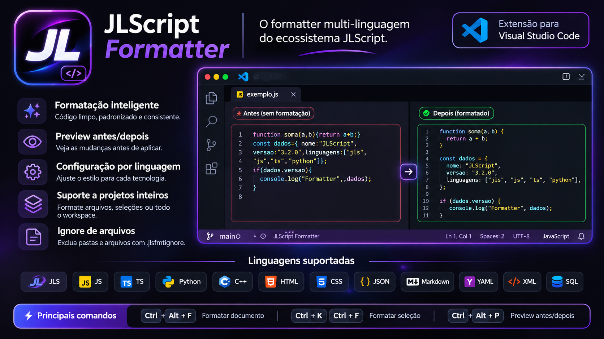

# JLScript Formatter

<p align="center">
  
</p>

<p align="center">
  
</p>

<p align="center">
  
</p>

<h1 align="center">JLScript Formatter</h1>

<p align="center">
  <strong>Um formatter rápido, simples e multi-linguagem criado dentro do ecossistema JLScript.</strong>
</p>

<p align="center">
  Formate JLScript, JavaScript, TypeScript, C++, Python, JSON, HTML, CSS e outras linguagens sem transformar seu código em uma obra abstrata.
</p>

<p align="center">
  <a href="https://marketplace.visualstudio.com/items?itemName=EohLczin.jlscript-formatter">
    
  </a>

  <a href="https://marketplace.visualstudio.com/items?itemName=EohLczin.jlscript-formatter">
    
  </a>

  

  
</p>

<p align="center">
  <a href="https://github.com/eohlczinn/JLScript-formatter">GitHub</a>
  ·
  <a href="https://marketplace.visualstudio.com/items?itemName=EohLczin.jlscript-formatter">VS Code Marketplace</a>
  ·
  <a href="#-atalhos">Atalhos</a>
  ·
  <a href="#-configura%C3%A7%C3%A3o">Configuração</a>
  ·
  <a href="#-antes-e-depois">Antes e Depois</a>
</p>

---

# ✨ O que é o JLScript Formatter?

O **JLScript Formatter** nasceu de uma necessidade bem simples:

> abrir um arquivo bagunçado, apertar um atalho e continuar programando.

Sem ficar arrumando espaço manualmente.

Sem mover chave pra um lugar que você não gosta.

Sem precisar instalar um formatter diferente para cada pequeno projeto.

E principalmente sem fazer isso:

```js
function somar(a, b)
{
  return a + b;
}
```

Aqui a regra é simples:

```js
function somar(a, b) {
  return a + b;
}
```

A `{` fica junto da declaração.

Sempre que a linguagem permitir esse estilo, essa é a identidade do formatter.

O projeto começou como um formatter para **JLScript**, mas acabou crescendo.

Hoje ele também consegue trabalhar com várias linguagens usadas no desenvolvimento de projetos reais.

---

# 💜 E o que é JLScript?

**JLScript** é uma linguagem de programação criada para ter uma sintaxe simples, direta e próxima de quem está aprendendo ou construindo projetos sem querer lutar contra a própria linguagem.

Um exemplo pequeno:

```jls
va nome = "Lucas"
va idade = 20

func apresentar(nome, idade) {
    mostrar("Nome: " + nome)
    mostrar("Idade: " + idade)
}

se (idade >= 18) {
    apresentar(nome, idade)
} senao {
    mostrar("Menor de idade")
}
```

A ideia da linguagem não é simplesmente traduzir JavaScript para português.

Ela possui seu próprio ecossistema, sintaxe, runtime e ferramentas.

Alguns exemplos:

```jls
va nome = "JLScript"

func soma(a, b) {
    retorne a + b
}

se (nome == "JLScript") {
    mostrar("Olá JLScript")
}
```

Também existem módulos e ferramentas do ecossistema:

```jls
import [#ui, #style]
```

E uma interface pode seguir uma estrutura declarativa:

```jls
va app = ui.janela()

app.titulo("Minha aplicação")

app.ui({
    div(class="container") {
        h1 = "JLScript"
        text = "Minha primeira interface"

        button(class="primario") {
            text = "Continuar"
        }
    }
})
```

O Formatter foi criado justamente para acompanhar esse ecossistema.

---

# 🚀 Por que criar outro formatter?

Porque eu queria algumas regras específicas.

Uma delas virou praticamente a regra número 1 do projeto:

```text
A chave de abertura fica na mesma linha.
```

Então:

```cpp
if (usuario.ativo) {
    executar();
}
```

e não:

```cpp
if (usuario.ativo)
{
    executar();
}
```

Além disso, eu queria uma ferramenta que pudesse ser usada não apenas com JLScript.

O mesmo formatter poderia trabalhar com:

```text
JLScript
JavaScript
TypeScript
React
C++
Python
HTML
CSS
JSON
Markdown
YAML
XML
SQL
```

A ideia foi crescendo até virar o que está aqui hoje.

---

# 🧩 Linguagens suportadas

| Linguagem | Extensões |
|---|---|
| 💜 JLScript | `.jls` |
| 🟨 JavaScript | `.js` |
| ⚛️ JSX | `.jsx` |
| 🔷 TypeScript | `.ts` |
| ⚛️ TSX | `.tsx` |
| 🐍 Python | `.py` |
| ⚙️ C++ | `.cpp`, `.cc`, `.cxx` |
| 📦 C/C++ Headers | `.h`, `.hpp`, `.hh`, `.chh` |
| 🌐 HTML | `.html`, `.htm` |
| 🎨 CSS | `.css` |
| 📋 JSON | `.json` |
| 📝 JSONC | `.jsonc` |
| 📖 Markdown | `.md`, `.markdown` |
| ⚙️ YAML | `.yaml`, `.yml` |
| 📰 XML | `.xml` |
| 🗄️ SQL | `.sql` |

---

# ⚡ Atalhos

Uma das ideias principais do formatter é não precisar ficar procurando botão.

## Windows / Linux

| Atalho | Função |
|---|---|
| `Ctrl + Alt + F` | Formatar arquivo atual |
| `Ctrl + K`, `Ctrl + F` | Formatar somente a seleção |
| `Ctrl + Alt + P` | Abrir preview antes/depois |
| `Shift + Alt + F` | Format Document padrão do VS Code |

## macOS

| Atalho | Função |
|---|---|
| `Cmd + Option + F` | Formatar arquivo atual |
| `Cmd + K`, `Cmd + F` | Formatar seleção |
| `Cmd + Option + P` | Preview antes/depois |

---

# 🧠 Comandos disponíveis

Abra:

```text
Ctrl + Shift + P
```

e procure por:

```text
JLScript Formatter
```

Você encontrará:

```text
JLScript Formatter: Formatar documento

JLScript Formatter: Formatar seleção

JLScript Formatter: Formatar projeto inteiro

JLScript Formatter: Preview antes/depois

JLScript Formatter: Ativar/Desativar formatar ao salvar

JLScript Formatter: Criar .jlsfmt.json

JLScript Formatter: Criar .jlsfmtignore
```

---

# 🔥 Antes e Depois

Essa é a parte mais importante.

O formatter precisa mostrar resultado, não fazer discurso bonito sobre indentação.

---

<details open>
<summary><strong>💜 JLScript</strong></summary>

<br>

### Antes

```jls
import [#ui,#style]

func soma(a,b)
{
va resultado=a+b
retorne resultado
}

va usuario={
nome:"Lucas",
idade:20,
ativo:true
}

se(usuario.ativo)
{
mostrar("Usuario ativo")
}
senao
{
mostrar("Usuario inativo")
}

para(va i=0;i<10;i++)
{
mostrar(i)
}
```

### Depois

```jls
import [#ui, #style]

func soma(a, b) {
    va resultado = a + b
    retorne resultado
}

va usuario = {
    nome: "Lucas",
    idade: 20,
    ativo: true
}

se (usuario.ativo) {
    mostrar("Usuario ativo")
} senao {
    mostrar("Usuario inativo")
}

para (va i = 0; i < 10; i++) {
    mostrar(i)
}
```

Esse é o principal objetivo do projeto.

O código continua sendo JLScript.

Só deixa de parecer que foi escrito durante uma fuga policial.

</details>

---

<details>
<summary><strong>🟨 JavaScript</strong></summary>

<br>

### Antes

```js
function somar(a,b)
{
const resultado=a+b;
return resultado;
}

const usuario={nome:"Lucas",idade:20,ativo:true};

if(usuario.ativo)
{
console.log("Ativo");
}
```

### Depois

```js
function somar(a, b) {
  const resultado = a + b;
  return resultado;
}

const usuario = {
  nome: "Lucas",
  idade: 20,
  ativo: true
};

if (usuario.ativo) {
  console.log("Ativo");
}
```

</details>

---

<details>
<summary><strong>⚛️ JSX</strong></summary>

<br>

### Antes

```jsx
function App()
{
const nome="JLScript";

return <div className="app"><h1>{nome}</h1><button onClick={()=>{console.log("clicou");}}>Clique</button></div>;
}
```

### Depois

```jsx
function App() {
  const nome = "JLScript";

  return (
    <div className="app">
      <h1>{nome}</h1>
      <button
        onClick={() => {
          console.log("clicou");
        }}
      >
        Clique
      </button>
    </div>
  );
}
```

</details>

---

<details>
<summary><strong>🔷 TypeScript</strong></summary>

<br>

### Antes

```ts
interface Usuario
{
nome:string;
idade:number;
ativo:boolean;
}

function criarUsuario(nome:string,idade:number):Usuario
{
return {nome:nome,idade:idade,ativo:true};
}
```

### Depois

```ts
interface Usuario {
  nome: string;
  idade: number;
  ativo: boolean;
}

function criarUsuario(nome: string, idade: number): Usuario {
  return {
    nome: nome,
    idade: idade,
    ativo: true
  };
}
```

</details>

---

<details>
<summary><strong>⚛️ TSX</strong></summary>

<br>

### Antes

```tsx
type Props={
titulo:string;
ativo:boolean;
};

function Card({titulo,ativo}:Props)
{
return <div><h2>{titulo}</h2>{ativo&&<span>Ativo</span>}</div>;
}
```

### Depois

```tsx
type Props = {
  titulo: string;
  ativo: boolean;
};

function Card({ titulo, ativo }: Props) {
  return (
    <div>
      <h2>{titulo}</h2>
      {ativo && <span>Ativo</span>}
    </div>
  );
}
```

</details>

---

<details>
<summary><strong>🐍 Python</strong></summary>

<br>

### Antes

```python
def somar(a,b):
 resultado=a+b
 return resultado

def usuario(nome,idade):
 return {"nome":nome,"idade":idade,"ativo":True}
```

### Depois

```python
def somar(a, b):
    resultado = a + b
    return resultado


def usuario(nome, idade):
    return {
        "nome": nome,
        "idade": idade,
        "ativo": True
    }
```

</details>

---

<details>
<summary><strong>⚙️ C++</strong></summary>

<br>

### Antes

```cpp
#include <iostream>

int somar(int a,int b)
{
return a+b;
}

int main()
{
if(somar(10,20)>20)
{
std::cout<<"OK"<<std::endl;
}

return 0;
}
```

### Depois

```cpp
#include <iostream>

int somar(int a, int b) {
    return a + b;
}

int main() {
    if (somar(10, 20) > 20) {
        std::cout << "OK" << std::endl;
    }

    return 0;
}
```

Repara novamente na regra:

```cpp
int main() {
```

e não:

```cpp
int main()
{
```

</details>

---

<details>
<summary><strong>📦 Headers C++</strong></summary>

<br>

### Antes

```cpp
class Calculadora
{
public:
int somar(int a,int b)
{
return a+b;
}
};
```

### Depois

```cpp
class Calculadora {
public:
    int somar(int a, int b) {
        return a + b;
    }
};
```

Suporte para:

```text
.h
.hpp
.hh
.chh
```

</details>

---

<details>
<summary><strong>🌐 HTML</strong></summary>

<br>

### Antes

```html
<html>
<body>
<div class="container">
<h1>JLScript Formatter</h1>
<p>Formatter multi-linguagem</p>
<button>Formatar</button>
</div>
</body>
</html>
```

### Depois

```html
<html>
  <body>
    <div class="container">
      <h1>JLScript Formatter</h1>
      <p>Formatter multi-linguagem</p>
      <button>Formatar</button>
    </div>
  </body>
</html>
```

</details>

---

<details>
<summary><strong>🎨 CSS</strong></summary>

<br>

### Antes

```css
.container
{
display:flex;
flex-direction:column;
padding:20px;
background:#11101a;
}

button
{
background:#7c3aed;
color:white;
}
```

### Depois

```css
.container {
  display: flex;
  flex-direction: column;
  padding: 20px;
  background: #11101a;
}

button {
  background: #7c3aed;
  color: white;
}
```

</details>

---

<details>
<summary><strong>📋 JSON</strong></summary>

<br>

### Antes

```json
{"nome":"JLScript Formatter","versao":"3.2.0","ativo":true,"linguagens":["jls","js","ts"]}
```

### Depois

```json
{
  "nome": "JLScript Formatter",
  "versao": "3.2.0",
  "ativo": true,
  "linguagens": [
    "jls",
    "js",
    "ts"
  ]
}
```

</details>

---

<details>
<summary><strong>📝 JSONC</strong></summary>

<br>

### Antes

```jsonc
{
"nome":"JLScript Formatter",
// versão atual
"versao":"3.2.0",
"ativo":true
}
```

### Depois

```jsonc
{
  "nome": "JLScript Formatter",
  // versão atual
  "versao": "3.2.0",
  "ativo": true
}
```

Comentários continuam existindo.

Porque apagar comentário de JSONC durante uma formatação seria uma forma bastante criativa de ser odiado.

</details>

---

<details>
<summary><strong>📖 Markdown</strong></summary>

<br>

### Antes

```md
#JLScript Formatter


Formatter oficial.


##Recursos

-Formatar
-Preview
-Configuração
```

### Depois

```md
# JLScript Formatter

Formatter oficial.

## Recursos

- Formatar
- Preview
- Configuração
```

</details>

---

<details>
<summary><strong>⚙️ YAML</strong></summary>

<br>

### Antes

```yaml
nome:    JLScript Formatter
versao:  3.2.0
ativo: true
```

### Depois

```yaml
nome: JLScript Formatter
versao: 3.2.0
ativo: true
```

</details>

---

<details>
<summary><strong>📰 XML</strong></summary>

<br>

### Antes

```xml
<projeto>
<nome>JLScript</nome>
<versao>3.2.0</versao>
<config>
<ativo>true</ativo>
</config>
</projeto>
```

### Depois

```xml
<projeto>
  <nome>JLScript</nome>
  <versao>3.2.0</versao>
  <config>
    <ativo>true</ativo>
  </config>
</projeto>
```

</details>

---

<details>
<summary><strong>🗄️ SQL</strong></summary>

<br>

### Antes

```sql
select id,nome,email from usuarios where ativo=true and idade>=18 order by nome asc;
```

### Depois

```sql
SELECT id,
  nome,
  email
FROM usuarios
WHERE ativo = true
  AND idade >= 18
ORDER BY nome ASC;
```

</details>

---

# 👀 Preview antes de alterar

Não quer formatar direto?

Use:

```text
Ctrl + Alt + P
```

O formatter abre uma visualização comparando:

```text
ORIGINAL  ↔  FORMATADO
```

Assim dá para conferir antes de aplicar.

---

# 💾 Format on Save

Também é possível formatar automaticamente ao salvar.

No VS Code:

```text
Ctrl + Shift + P
```

Procure:

```text
JLScript Formatter: Ativar/Desativar formatar ao salvar
```

Ou configure:

```json
{
  "editor.formatOnSave": true,
  "jlsFormatter.enable": true
}
```

---

# ⚙️ Configuração

O formatter pode funcionar sem nenhuma configuração.

Mas caso você queira mudar o comportamento, crie:

```text
.jlsfmt.json
```

Exemplo:

```json
{
  "printWidth": 100,
  "quotes": "preserve",
  "semicolons": true,
  "trailingComma": "none",
  "bracketSpacing": true,
  "organizeImports": false,
  "cache": true,

  "languages": {
    "javascript": {
      "indentSize": 2
    },

    "typescript": {
      "indentSize": 2
    },

    "jls": {
      "indentSize": 4
    },

    "python": {
      "indentSize": 4
    },

    "cpp": {
      "indentSize": 4
    },

    "json": {
      "indentSize": 2
    }
  }
}
```

---

<details>
<summary><strong>🎛️ Ver opções disponíveis</strong></summary>

<br>

### `printWidth`

Largura preferida:

```json
{
  "printWidth": 100
}
```

---

### `quotes`

```json
{
  "quotes": "single"
}
```

Valores:

```text
preserve
single
double
```

---

### `semicolons`

```json
{
  "semicolons": true
}
```

---

### `trailingComma`

```json
{
  "trailingComma": "multiline"
}
```

Valores:

```text
none
multiline
all
```

---

### `bracketSpacing`

```json
{
  "bracketSpacing": true
}
```

Resultado:

```js
const usuario = { nome: "Lucas" };
```

---

### `organizeImports`

```json
{
  "organizeImports": true
}
```

Por padrão:

```json
{
  "organizeImports": false
}
```

porque ordenar imports já é uma alteração um pouco maior que simples espaçamento.

</details>

---

# 🚫 `.jlsfmtignore`

Nem tudo precisa ser formatado.

Crie:

```text
.jlsfmtignore
```

Exemplo:

```gitignore
node_modules/
dist/
build/
coverage/
vendor/

*.min.js
*.min.css
```

Assim:

```bash
jlsfmt .
```

não sai entrando em milhares de arquivos que ninguém pediu para tocar.

---

# ⚡ Cache

Arquivos que não foram modificados não precisam ser processados novamente.

O formatter possui cache para reduzir trabalho repetido.

Executar normalmente:

```bash
jlsfmt .
```

Desativar cache:

```bash
jlsfmt . --no-cache
```

Limpar cache:

```bash
jlsfmt . --clear-cache
```

---

# 💻 CLI

O formatter não depende do VS Code.

Ele também possui CLI:

```bash
jlsfmt
```

Ver versão:

```bash
jlsfmt --version
```

Formatar um arquivo:

```bash
jlsfmt app.js
```

JLScript:

```bash
jlsfmt main.jls
```

C++:

```bash
jlsfmt main.cpp
```

JSON:

```bash
jlsfmt package.json
```

Projeto inteiro:

```bash
jlsfmt .
```

---

# ✅ Check

Quer saber se os arquivos estão formatados sem modificar nada?

```bash
jlsfmt . --check
```

O formatter pode mostrar diferenças:

```diff
-function somar(a,b)
-{
-return a+b;
+function somar(a, b) {
+  return a + b;
 }
```

Isso também abre espaço para uso em:

```text
GitHub Actions
CI
pipelines
pré-commit
testes
```

---

# 🎯 Formatação de seleção

Nem sempre você quer mexer no arquivo inteiro.

Selecione apenas uma parte:

```text
Ctrl + K
Ctrl + F
```

O formatter trabalha somente naquela seleção.

---

# 🧩 Plugins

O JLScript Formatter também foi pensado para crescer sem colocar todas as linguagens possíveis dentro do núcleo.

Um plugin pode registrar novas extensões:

```js
module.exports = {
  extensions: [".lua"],

  format(source, options) {
    return source;
  }
};
```

Depois:

```json
{
  "plugins": [
    "./tools/jlsfmt-plugin-lua.cjs"
  ]
}
```

Isso abre espaço para coisas como:

```text
jlsfmt-plugin-lua
jlsfmt-plugin-rust
jlsfmt-plugin-java
```

---

# 🌍 Mais do que VS Code

O formatter possui suporte a entrada e saída que permite integração com outros editores.

A ideia é simples:

```text
                   JLScript Formatter
                           │
          ┌────────────────┼────────────────┐
          │                │                │
          ▼                ▼                ▼
       VS Code       Visual Studio       Neovim
          │                │                │
          ▼                ▼                ▼
       Sublime            Zed           JetBrains
```

O motor continua sendo o mesmo.

O que muda é apenas a integração com cada editor.

---

# 🏗️ Arquitetura

```text
JLScript Formatter
│
├── Core
│   ├── detector de linguagem
│   ├── formatter
│   ├── configuração
│   ├── cache
│   ├── ignore
│   └── plugins
│
├── CLI
│   └── jlsfmt
│
└── VS Code Extension
    ├── Format Document
    ├── Format Selection
    ├── Format Workspace
    ├── Preview
    └── Format on Save
```

---

# 🧪 Princípios do formatter

O projeto segue algumas regras que considero importantes:

```text
✓ resultado previsível

✓ não modificar a lógica do programa

✓ preservar strings

✓ preservar comentários

✓ evitar transformações agressivas

✓ permitir configuração por linguagem

✓ manter comportamento consistente

✓ formatar novamente sem mudar o resultado

✓ chave de abertura na mesma linha
```

Essa última merece repetir.

Sim:

```js
function executar() {
}
```

Não:

```js
function executar()
{
}
```

Tem coisas que simplesmente não deveriam precisar de discussão.

---

# ♻️ Idempotência

Uma regra importante de qualquer formatter:

```text
Código original
      ↓
Formatter
      ↓
Código formatado
      ↓
Formatter novamente
      ↓
MESMO código
```

Formatar um arquivo duas vezes não deveria continuar alterando ele.

O formatter tenta manter esse comportamento nas linguagens suportadas.

---

# 🛡️ Transformações conservadoras

Algumas linguagens são mais delicadas que outras.

Por isso o formatter tenta ser mais conservador onde uma transformação agressiva poderia alterar comportamento ou estrutura.

Especialmente em formatos como:

```text
Markdown
YAML
XML
SQL
JSONC
```

Melhor deixar uma linha menos bonita do que transformar um arquivo válido em decoração de parede.

---

# 💜 Ecossistema JLScript

O Formatter não é um projeto isolado.

Ele faz parte de uma ideia maior.

```text
JLScript
│
├── JLScript Core
│
├── JLS CLI
│
├── JLShell
│
├── JLScript Formatter
│
├── JLScript Language Server
│
├── VS Code Extension
│
├── Visual Studio Extension
│
└── JLS AI
```

O objetivo é cada ferramenta ter sua própria responsabilidade.

O runtime executa.

O formatter formata.

O Language Server entende o código dentro dos editores.

As extensões fazem a integração.

E todas continuam fazendo parte do mesmo ecossistema.

---

# 📦 Instalação

## VS Code Marketplace

Abra:

```text
Ctrl + Shift + X
```

Pesquise:

```text
JLScript Formatter
```

ou acesse:

[JLScript Formatter no Visual Studio Marketplace](https://marketplace.visualstudio.com/items?itemName=EohLczin.jlscript-formatter)

---

## Instalação por VSIX

Também é possível instalar manualmente:

```text
Ctrl + Shift + P
```

depois:

```text
Extensions: Install from VSIX...
```

Escolha:

```text
jlscript-formatter-x.x.x.vsix
```

---

# 📂 Repositório

GitHub:

[github.com/eohlczinn/JLScript-formatter](https://github.com/eohlczinn/JLScript-formatter)

---

# 🗺️ Próximos passos

Algumas ideias para as próximas versões:

```text
□ melhorar formatação de SQL

□ aprofundar suporte a Markdown

□ melhorar YAML

□ ampliar suporte JSX/TSX

□ integração com Visual Studio

□ integração com Neovim

□ integração com Sublime

□ plugins adicionais

□ melhorar performance em projetos grandes

□ novos modos de preview

□ integração maior com JLScript
```

---

# ⭐ Contribuindo

Encontrou código que o formatter tratou errado?

Uma das melhores formas de ajudar é criar uma Issue mostrando:

### Entrada

```text
código antes
```

### Resultado atual

```text
resultado produzido
```

### Resultado esperado

```text
como deveria ficar
```

Isso deixa o problema reproduzível e muito mais simples de corrigir.

---

# 📜 Versão atual

```text
JLScript Formatter v3.2.0
```

---

# 👨‍💻 Projeto

Criado como parte do ecossistema **JLScript / JLScripter**.

Desenvolvido por **Lucas**.

---

<p align="center">
  
</p>

<h3 align="center">JLScript Formatter</h3>

<p align="center">
  <strong>Seu código. Suas regras. Menos tempo arrumando espaço.</strong>
</p>

<p align="center">
  <a href="https://github.com/eohlczinn/JLScript-formatter">GitHub</a>
  ·
  <a href="https://marketplace.visualstudio.com/items?itemName=EohLczin.jlscript-formatter">Marketplace</a>
</p>
